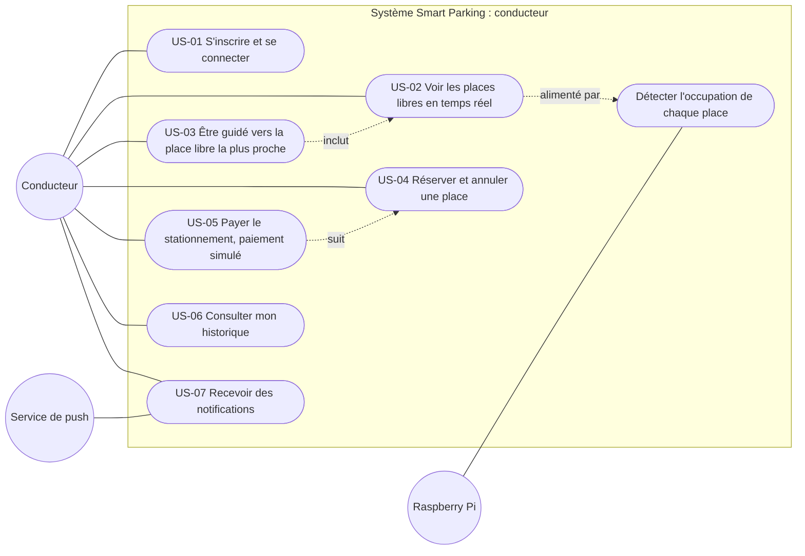
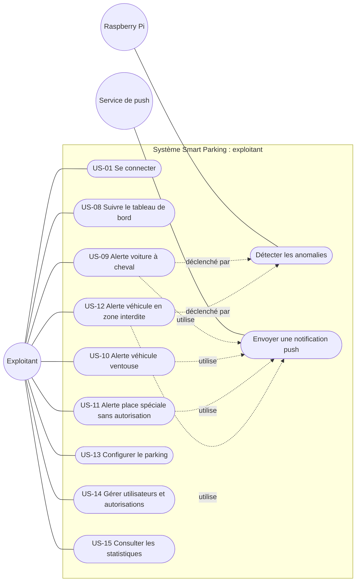

# Diagrammes de cas d'utilisation

Source : [user stories](../user-stories.md) (US-01 à US-15) et cahier des charges. Chaque cas d'utilisation porte le numéro de sa story. Deux diagrammes, un par interface, pour rester lisibles.

## Les acteurs

| Acteur | Rôle |
|---|---|
| **Conducteur** | Utilise l'interface conducteur de la PWA (rôle `CONDUCTEUR`). |
| **Exploitant** | Gère le parking depuis l'interface exploitant de la PWA (rôle `EXPLOITANT`). |
| **Raspberry Pi** | Acteur technique : il analyse l'image de la caméra, envoie l'état des places et les anomalies. |
| **Service de push** | Acteur externe (Google, Mozilla, Apple) qui livre les notifications au navigateur. |

## 1. Interface conducteur

## 2. Interface exploitant

## Remarques

- **US-01** est partagée : un exploitant se connecte comme un conducteur, mais ne s'inscrit pas. Son compte est créé par un autre exploitant (US-14).
- **Voiture à cheval** (US-09) et **zone interdite** (US-12) sont détectées par le **Pi**, qui les envoie en MQTT. **Ventouse** (US-10) et **place spéciale** (US-11) sont calculées par le **serveur** à partir de l'état des places, de la durée et des autorisations : elles n'ont donc pas de lien direct avec le Pi dans le diagramme.
- Le conducteur reçoit lui aussi des notifications (US-07) : réservation confirmée, fin de durée, place à libérer, place prise.
- Hors périmètre, selon le cahier des charges : reconnaissance de plaques ou de visages, verbalisation automatique, guidage routier dans la ville, paiements réels.
