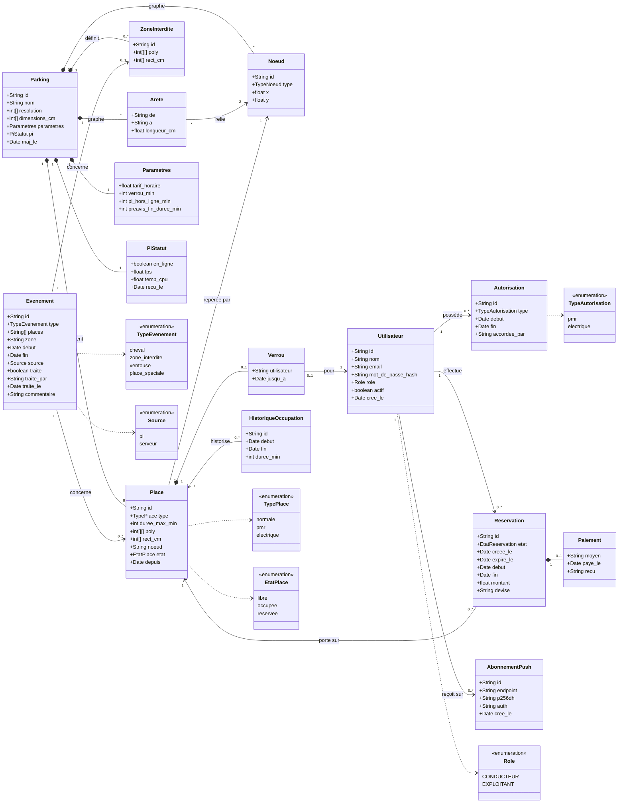
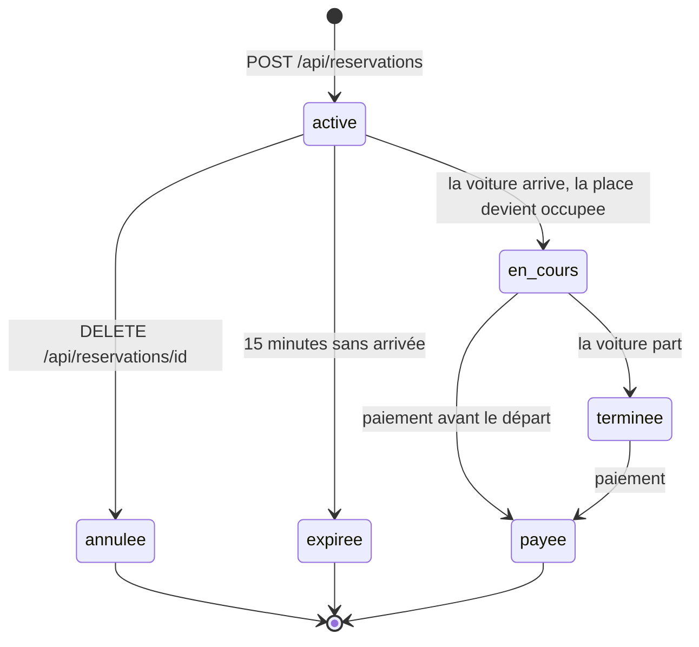

# Diagramme de classes et états

Source : [contrats, section 2.14](../contrats.md) (collections MongoDB), 2.7 (guidage), 2.8 (réservations), 2.9 (événements) et 4.3 (plan). Chaque classe correspond à une collection MongoDB, ou à un objet **imbriqué** dans un document (indiqué en note).

Aucune classe ne contient d'image, de plaque ou de visage : uniquement des états, des horaires et des comptes (*privacy by design*).

## Modèle du métier

Notes de lecture :
- **Imbriqués dans le document `parkings`** : le graphe (`Noeud`, `Arete`), les `ZoneInterdite`, les `Parametres` et le `PiStatut`.
- **Imbriqués dans `places`** : le `Verrou` (`null` s'il n'y a pas de guidage en cours).
- **Imbriqué dans `reservations`** : le `Paiement`.
- L'état `reservee` d'une place n'est **pas** envoyé par le Pi : le serveur le calcule quand une place libre a une réservation active. Le Pi ne connaît que `libre` et `occupee`.
- `HistoriqueOccupation` contient un document par stationnement terminé, pour les statistiques.

## Cycle de vie d'une réservation

Source : contrats, section 2.8.

Règles associées :
- Un conducteur n'a qu'**une** réservation `active` ou `en_cours` à la fois.
- Le paiement est **simulé** : le moyen vaut toujours `simule`, aucune donnée bancaire n'est demandée ni stockée.
- Le montant est le tarif horaire multiplié par la durée arrondie au quart d'heure supérieur (un quart d'heure au minimum).

## Types de place et autorisations

| Type de place | Qui peut la recevoir par le guidage |
|---|---|
| `normale` | tous les conducteurs |
| `pmr` | un conducteur ayant une autorisation `pmr` valide |
| `electrique` | un conducteur ayant une autorisation `electrique` valide |

La caméra ne voit pas les badges : l'alerte `place_speciale` s'appuie sur les autorisations enregistrées dans le système.
