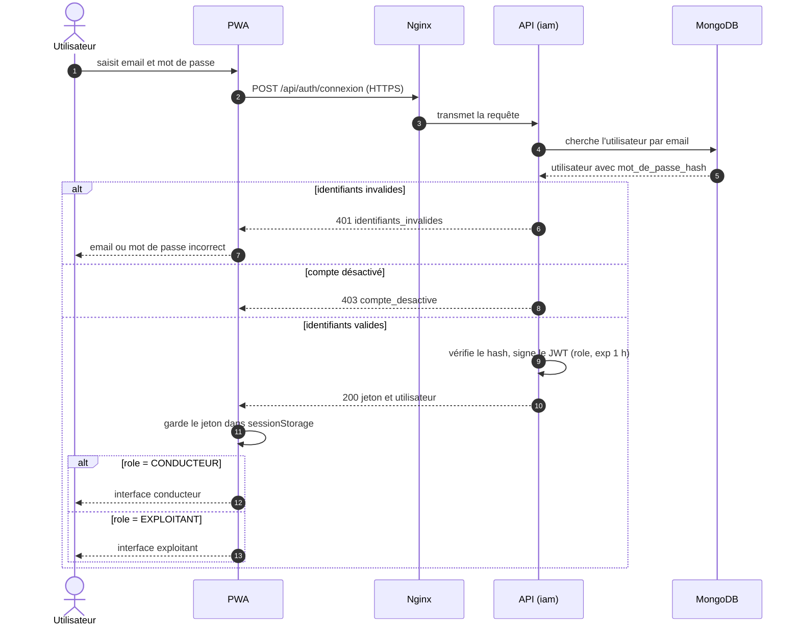
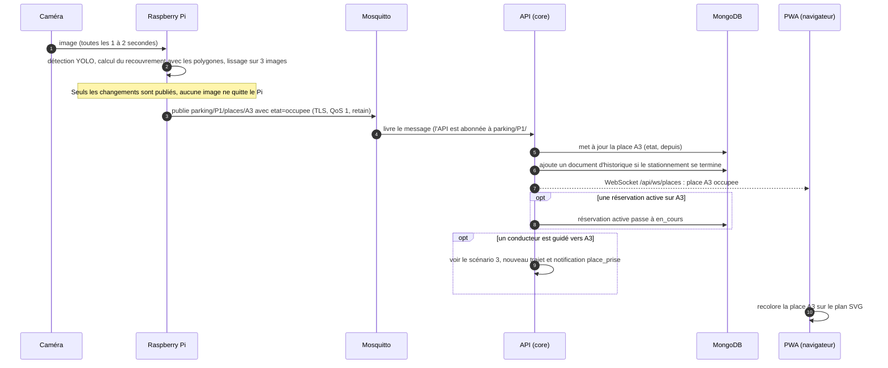
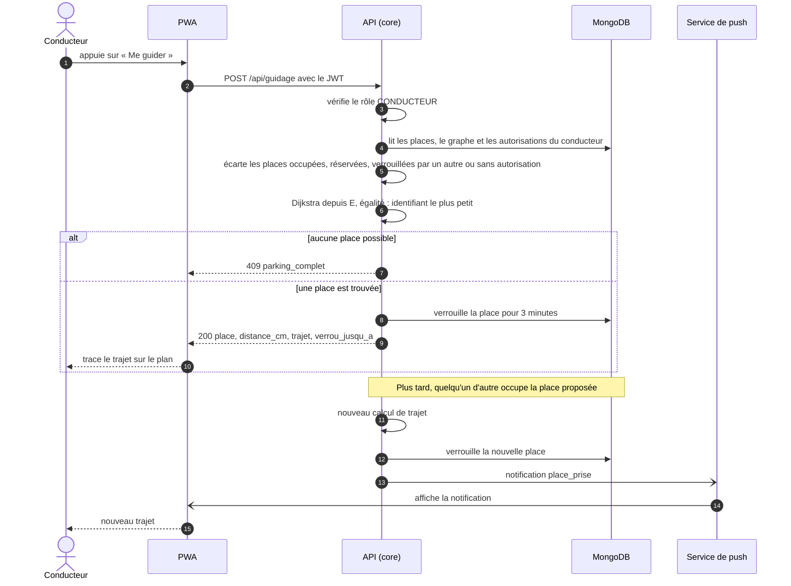
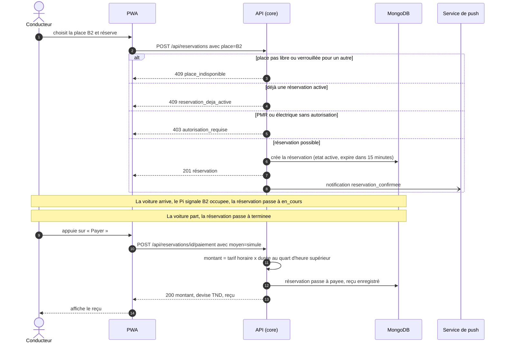
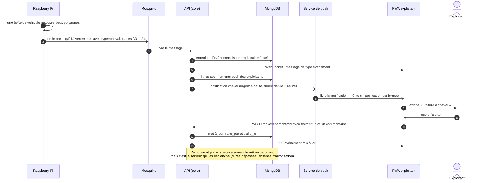
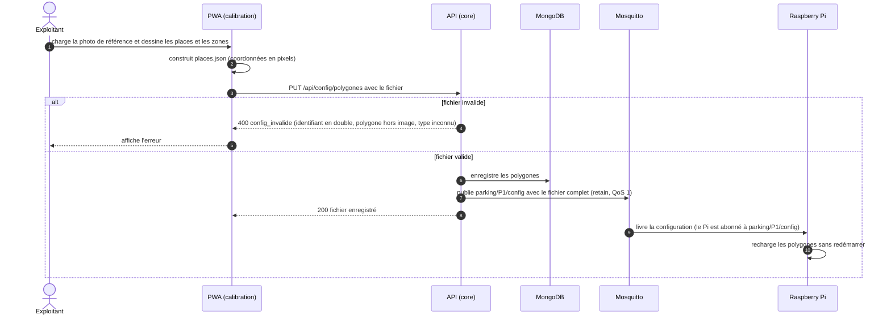

# Diagrammes de séquence

Six scénarios de bout en bout. Les noms des routes, des topics MQTT et des messages sont ceux des [contrats](../contrats.md).

Participants :
- **PWA** : l'application dans le navigateur (conducteur ou exploitant) ;
- **Nginx** : la porte d'entrée HTTPS de la VM ;
- **API** : le middleware WildFly (`middleware/api`, qui appelle `iam` et `core`) ;
- **MongoDB** : la base de données ;
- **Mosquitto** : le broker MQTT (TLS, port 8883) ;
- **Pi** : le Raspberry Pi, avec la caméra.

## 1. Inscription et connexion (US-01)

Contrats 2.2 et 2.5. Le jeton est un JWT signé RS256, valable 1 heure.

## 2. Occupation d'une place, du Pi à l'écran (US-02, US-08)

Contrat 1.4 (WebSocket) et 5.1 (MQTT). C'est la chaîne complète de la démo du sprint 6.

## 3. Guidage vers la place libre la plus proche (US-03)

Contrat 2.7. Le plus court chemin est calculé avec Dijkstra dans le graphe de la maquette.

## 4. Réservation et paiement simulé (US-04, US-05)

Contrat 2.8. Le paiement est simulé : aucune donnée bancaire n'est demandée.

## 5. Anomalie détectée et notification (US-09 à US-12)

Contrats 5.1 (MQTT) et section 3 (push). Exemple : voiture à cheval sur A3 et A4.

## 6. Configuration des polygones (US-13)

Contrats 2.10 et 5.3. L'exploitant dessine les places sur une photo prise par le Pi, le serveur les enregistre et les publie au Pi.

