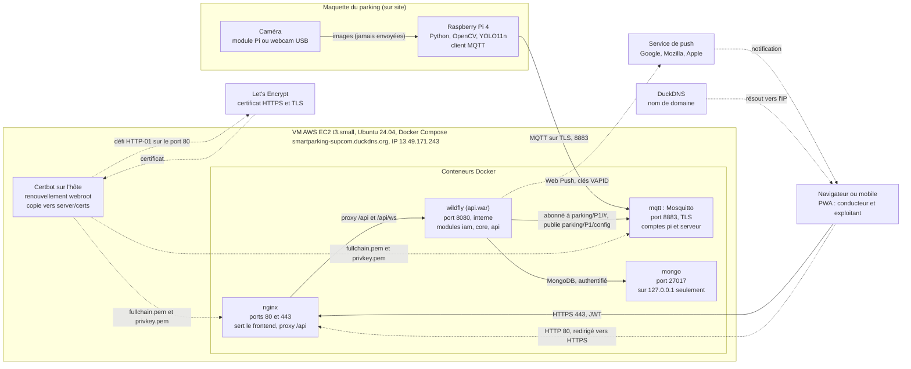

# Diagramme de déploiement

Source : [`server/docker-compose.yml`](../../server/docker-compose.yml), [`docs/installation-serveur.md`](../installation-serveur.md) et cahier des charges. L'état décrit est celui **vérifié le 10 novembre 2026** sur la VM.

## Ce que montre le diagramme

| Élément | Détail |
|---|---|
| **Seuls `nginx` et `mqtt` sont joignables depuis Internet** | par les ports 80, 443 et 8883. |
| **`wildfly` n'a aucun port publié** | on y accède uniquement par Nginx. |
| **`mongo` n'écoute que sur `127.0.0.1`** | la base n'est pas exposée ; on s'y connecte par un tunnel SSH. |
| **Un seul certificat** | celui de Let's Encrypt sert à Nginx (HTTPS) et à Mosquitto (TLS). |
| **Aucune image ne quitte le Pi** | seuls l'état des places et les événements partent, en MQTT (*privacy by design*). |

## Ports et protocoles

| Port | Service | Ouvert à Internet | Protocole |
|---|---|---|---|
| 22 | SSH (administration) | oui | SSH, par clé |
| 80 | Nginx | oui | HTTP, redirige vers HTTPS, sert le défi Let's Encrypt |
| 443 | Nginx | oui | HTTPS (TLS 1.2 et 1.3), PWA, `/api`, WebSocket |
| 8883 | Mosquitto | oui | MQTT sur TLS, mot de passe obligatoire, droits par compte (ACL) |
| 8080 | WildFly | **non** | HTTP, réseau Docker seulement |
| 27017 | MongoDB | **non** | protocole MongoDB, `127.0.0.1` seulement |

## Écart connu avec les tests locaux

Sur la VM, MongoDB tourne en version **7.0** (et non 8.0 comme dans `docker-compose.yml`), parce que le noyau Linux 7.0 de la VM empêche MongoDB 8.0 de démarrer. Voir la section 4.4 de [`installation-serveur.md`](../installation-serveur.md).
